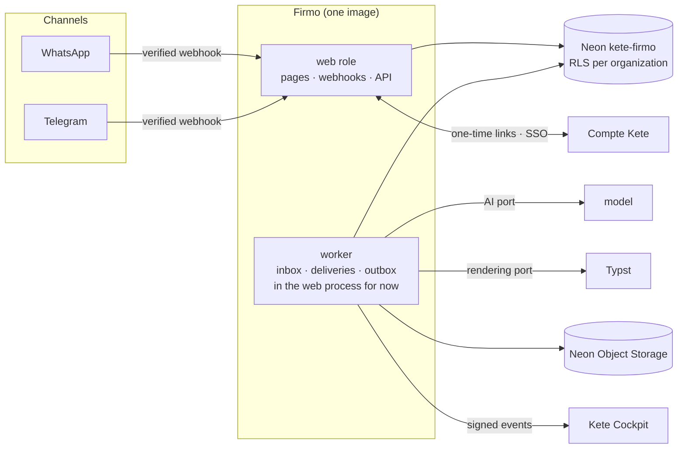

# Architecture — Firmo

Firmo is a Kete app (doctrine `ARCHITECTURE_APP.md`): one deployment, cut into business features,
with ports for everything external. This page is kept in step with the code, in the same pull
request (D-017).

## The whole

The phases that bring each part are in `ROADMAP.md`. Delivered: the web role with `/health`,
`/.well-known/kete` and the outbox (phase 0); the document — model, calculations, numbering,
issuance, PDF (phase 1, `src/features/documents/README.md`); identity — a sender is one Compte
Kete person and organization, the web space opens through a one-time link (phase 2,
`src/features/identity/README.md`); the conversation — a bounded agent with guarded tools, the
inbox and its worker, WhatsApp, Telegram and OpenAI adapters (phase 3,
`src/features/conversation/README.md`, decisions 0001 and 0002); the client space — documents,
editing, issuance, share links, presentation (phase 4, `src/features/space/README.md`); three
document types, each with its own life (phase 4.1, `specs/006-document-types`); plans — offered
documents, then the Compte Kete's Firmo offer, counted under an issuance lock, and the model's cost
measured (phase 5, `src/features/plans/README.md`); operations — Kete operators' space, the
journal, and Firmo's events to Kete Cockpit (phase 6, `src/features/operations/README.md`).

## Layers

| Layer       | Holds                                                           | Depends on    |
| ----------- | --------------------------------------------------------------- | ------------- |
| Surfaces    | routes (pages, webhooks, API), worker jobs                      | application   |
| Application | use cases (issue a document, read a message) and their policies | domain, ports |
| Domain      | money, calculations, numbering, lifecycle — pure functions      | nothing       |
| Ports       | messaging, AI, rendering, storage, payments, events             | —             |
| Adapters    | WhatsApp, Telegram, OpenAI, Typst, Neon, Compte Kete            | ports         |

No vendor name in the domain or application layers (constitution V).

## Data

- One Neon project, `kete-firmo`, branches `main` (production), `dev` (staging), `test` (CI).
- Two roles: `firmo_owner` runs migrations; `firmo_app` serves requests and **cannot bypass
  RLS**. Every business table carries `organization_id` and is created with its policy
  (`organization_id = public.current_organization_id()`).
- `src/platform/tenancy.ts` sets the organization per transaction, after a verified proof.
- Migrations are hand-written SQL in `db/migrations/` (journal in `meta/_journal.json`),
  applied with `pnpm db:migrate [test|dev|main]`.

## Kete

- `@kete/*` are `@kete-africa/*` published by kete-core on GitHub Packages (kete-core decision
  0005), aliased in `package.json`; reading them needs `KETE_PACKAGES_TOKEN`.
- The outbox (`kete_outbox`, from `@kete/sdk`) carries Firmo's events to Kete Cockpit.
