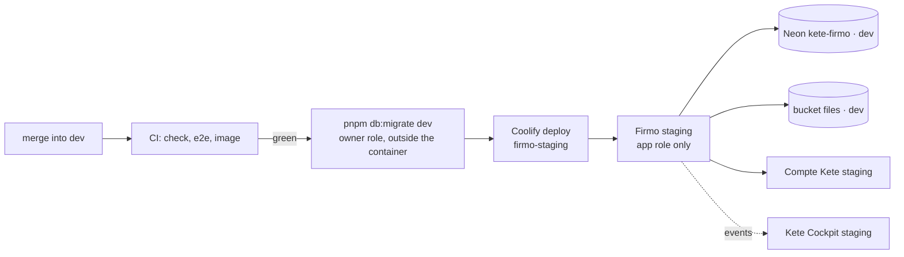

# Operations — Firmo

Where Firmo runs and how it goes live. No secret here: values live in Coolify and in the author's
local `.env` (never committed).

## Staging

| What           | Where                                                                                            |
| -------------- | ------------------------------------------------------------------------------------------------ |
| Address        | <https://firmo-staging.13.140.178.49.sslip.io>                                                   |
| Coolify        | project `Kete`, environment `staging`, application `firmo-staging` (`tzhsp5ehomtd4bpmgjkvcgr7`)  |
| Source         | GitHub App `kete-coolify` (owned by `kete-africa`), repository `kete-africa/firmo`, branch `dev` |
| Image          | `Dockerfile` at the root; Typst inside; the image probes its own `/health`                       |
| Database       | Neon `kete-firmo`, branch `dev`, application role `firmo_app` (no BYPASSRLS)                     |
| Object storage | bucket `files` of the same branch; credential `kete-firmo-staging`                               |
| Compte Kete    | <https://compte-kete-staging.13.140.178.49.sslip.io> (kete-core `docs/OPERATIONS.md`)            |

### Environment of the application

Runtime only — none is available at build time:

- `FIRMO_DATABASE_URL` (application role of `dev`), `FIRMO_URL` (the address above),
  `KETE_ENVIRONMENT=staging`, `FIRMO_WORKER=on`, `FIRMO_STORAGE_*`.
- `FIRMO_SESSION_SECRET`: staging's own, generated once in Coolify and never read back; replacing
  it ends every Firmo session.
- `KETE_ACCOUNT_URL`; `FIRMO_CLIENT_ID`, `FIRMO_CLIENT_SECRET` and
  `KETE_OPERATORS_ORGANIZATION_ID` — set by kete-core's `staging:operator` (below).
- `OPENAI_*`: the conversation's model.
- Messaging, once decided: `TELEGRAM_BOT_TOKEN`, `TELEGRAM_WEBHOOK_SECRET`; `WHATSAPP_*`;
  `FIRMO_WHATSAPP_NUMBER`, `FIRMO_TELEGRAM_BOT`.
- Kete Cockpit, once Firmo is registered there: `KETE_RECEIVER_URL`, `KETE_KEY_ID`,
  `KETE_KEY_SECRET`.

Build time only: `KETE_PACKAGES_TOKEN` (read:packages), passed as a Docker build secret
(Coolify's _use build secrets_ is on) — never an image layer.

### Deploying

1. Merge into `dev` once every check is green.
2. Migrate `dev` with the **owner** role — the container never holds it: `pnpm db:migrate dev`
   (reads `FIRMO_DEV_OWNER_URL` from the local `.env`).
3. Deploy: `POST /api/v1/deploy` on Coolify with `{"uuid": "tzhsp5ehomtd4bpmgjkvcgr7"}`.
4. Check: `/health` says `healthy`, `/.well-known/kete` says `staging` with its three events.

Steps 2 and 3 run from the author's machine until a deploy-only Coolify token exists.

### Connecting it — the author's gestures

1. **Compte Kete and operators**: kete-core's `pnpm --filter @kete/account staging:operator`
   (after signing up on the staging Compte Kete, creating the organization « Kete » and turning on
   two-factor). It registers Firmo with `kete:people`, sets its client and the operators'
   organization on `firmo-staging`, and redeploys it. Until then, `/espace` and `/operations`
   answer 500: Firmo cannot sign anyone in.
2. **Kete Cockpit**: register `https://firmo-staging.13.140.178.49.sslip.io` in the Cockpit; give
   `firmo-staging` the shown key (`KETE_KEY_ID`, `KETE_KEY_SECRET`) and
   `KETE_RECEIVER_URL=https://cockpit-kete-staging.13.140.178.49.sslip.io/api/events`; redeploy.
3. **Subscriptions**: the Firmo offer in the Compte Kete (`offers set --app firmo …`, kete-core)
   and its Chariow product, published in the Chariow dashboard.
4. **Messaging**: the bot `VTT_Firmo_bot` and the WhatsApp number currently serve the previous
   Firmo (`api-staging.vttlife.com`). Pointing them at this staging takes them from it: the
   author decides when. Then: set the variables above, and
   - Telegram: `setWebhook` to `…/webhooks/telegram` with the secret token;
   - WhatsApp: in Meta's dashboard, the callback `…/webhooks/whatsapp` and the verify token.

## Production

Nothing follows `main` yet. The production application is created when the author decides the
first release (branch `main`, Neon `main`, its own secrets, storage credential and domain).
