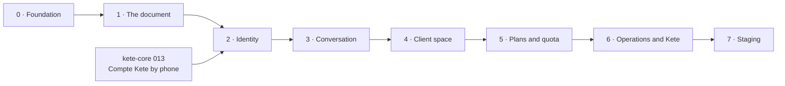

# Roadmap — Firmo

## Metadata

- **Status**: `candidate`
- **Last updated**: `2026-09-29`
- **Product boundary**: a tradesman's quotes, proformas and invoices, from a voice note, a photo or
  a text on WhatsApp or Telegram — his prices, our presentation.
- **Planning axis**: `DEPENDENCIES_AND_EVIDENCE_NOT_TIME`
- **Deployment policy**: `HUMAN_VALIDATION_BEFORE_DEPLOY`

## Goal

A tradesman sends his sale out loud tonight and gets a quote he accepts to send, without an
intermediary, without an account to create — and Kete sees Firmo live among its apps.

## Execution rules

- Phases are contiguous and close on their **proof**, never on a date.
- Each phase is one Spec Kit feature (`specs/NNN-slug`), branched from `dev`, merged on green CI.
- The reference version (`Jean-claude21/firmo`) is the oracle: a business rule it tested is ported
  with its test, or its absence is recorded in `docs/decisions/`.
- **Isolation is proven in every phase that touches people or data**: two organizations never see
  each other; two numbers on the same phone and browser never share a session; a reply goes only
  to the sender.
- `[agent]` is verified automatically; `[human]` waits for the author.

---

## Phase 0 — Foundation · `specs/001-foundation` · _closed on the CI of pull request #1_

### Objective

A repository an agent can work in safely, and an app that describes itself.

### Scope

- Constitution, context, Spec Kit, product decisions carried over (`docs/product/`).
- TypeScript strict, lint, formatting, catalogs check, CI; `@kete/*` from GitHub Packages (kete-core 0005).
- Neon project `kete-firmo` (`main`, `dev`, `test`), owner and application roles, Neon Object
  Storage bucket per branch.
- The app: TanStack Start on `@kete/design`, French and English, `/health`, `/.well-known/kete`;
  one image with two roles (web, worker), Typst inside.

### Proof

- `[agent]` CI runs lint, types, formatting, catalogs, tests and the image's health on every pull
  request to `dev`.

---

## Phase 1 — The document · `specs/002-documents` · _delivered_

### Objective

Firmo composes an exact, immutable, professional document from structured lines.

### Scope

- The model: organization profile (header, logo, colour, defaults), clients, clauses, usual items
  (memory, never suggestion), documents (quote, proforma, invoice), sections, lines, ordered
  adjustments (labour, transport, discount, tax), payments on invoices.
- Exact decimal calculations, numbering per type (series, annual or continuous, manual number,
  revisions `/R2`), issuance that burns the number and freezes totals, header and clauses;
  conversion quote → proforma → invoice without retyping; revisions linked to their root.
- The PDF through a rendering port (Typst adapter, the reference template and fonts).
- Every table with its RLS policy in its creating migration.

### Proof

- `[agent]` The reference's calculation, numbering, snapshot and lineage tests pass, ported.
- `[agent]` The nine reference cases render to PDF with the expected totals.
- `[agent]` Two organizations: neither lists, reads nor issues the other's documents (404).

---

## Phase 2 — Identity · `specs/003-identity` · _delivered_

### Dependencies

kete-core 013 (the Compte Kete by phone number, doctrine D-024).

### Objective

Each person who writes to Firmo is one Compte Kete person, one organization, one session.

### Scope

- A messaging identity (channel, sender) resolves to a Compte Kete person by phone number and to
  her organization; created in silence on the first message (WhatsApp: the sender's number;
  Telegram: the contact she shares once, checked against the sender).
- The web: one-time sign-in link requested for that person → Compte Kete → single sign-on into
  Firmo; a link always replaces the previous session; the session is an HTTP-only cookie.
- Number lost or changed: the e-mail added in Mon espace Kete, or a traced operator gesture.

### Proof

- `[agent]` Two numbers on the same browser: opening B's link after A's shows B, never A.
- `[agent]` A Telegram contact that is not the sender's own is refused.

---

## Phase 3 — Conversation · `specs/004-conversation` · _delivered; one human proof pending_

### Objective

A voice note, a photo or a text becomes a reading, then a draft, then an issued PDF — in the chat.

### Scope

- A messaging port with WhatsApp and Telegram adapters (verified webhooks), a durable inbox and a
  worker; replies only to the sender; WhatsApp's 24-hour window respected (templates outside it).
- An AI port with an OpenAI adapter: transcription, reading of a photo, and one agent turn per
  message acting through guarded tools (decision 0002); the reading is shown before composing;
  nothing invented, prices never touched.
- The first-document question (the name it leaves under); preview, issuance, PDF sent in the
  chat; usual items remembered; commands (open my space, subscribe, help).
- The reference's conversation journeys and evaluation sets, run against a fake model in CI and
  against the real one on demand. A new field bench of real dictations comes later.

### Proof

- `[agent]` The reference journeys pass; two senders in parallel never see each other's drafts.
- `[human]` The author completes a real quote on Telegram.

---

## Phase 4 — Client space · `specs/005-client-space` · _delivered_

### Objective

The tradesman makes the document his, from his phone.

### Scope

- Home, documents, the draft editor, presentation (header, logo, colour, clauses, numbering),
  purpose-built at 375 px from the validated reference screens, French and English.
- A share link per document for his client: the PDF, read-only, revocable; its opening is counted
  (Firmo's usage indicator), without IP or fingerprint.
- Said at first use: voice notes and photos are never kept — only what was heard or read (phase 3
  already erases message bodies once handled).

### Proof

- `[agent]` End to end at 375 px, in both languages; a share link opens one document, never a
  list, and stops after revocation.

---

## Phase 4.1 — Three document types · `specs/006-document-types` · _delivered_

### Objective

A quote, a proforma and an invoice are three documents with three purposes — never one document
under three titles.

### Scope

- Each type prints what it is for: a quote proposes (validity, deposit, "bon pour accord"); a
  proforma announces the invoice for the client's procedures (validity, deposit, no accounting
  value, "bon pour commande"); an invoice claims payment (no validity nor requested deposit,
  payments and balance, "pour acquit").
- Each type lives its own life (`domain/lifecycle.ts`, migration 0007): a quote is accepted,
  refused or left unanswered; a proforma is ordered or refused; an invoice is paid or cancelled,
  never accepted nor revised. Conversion goes forward only.
- The console and the chat say it: expired, ordered, to pay, paid; a quote by default in the chat.

### Proof

- `[agent]` Lifecycle and printing per type (unit); refusals held by the code and the database
  (integration).

---

## Phase 5 — Plans and quota · `specs/007-plans` · _delivered_

### Objective

Firmo is paid through the Compte Kete, and never gives more than what was bought.

### Scope

- Three final documents offered; then the Firmo offer of the Compte Kete (Chariow through the
  payment port, in the Compte Kete): thirty documents per rolling thirty days while it is active,
  counted and consumed under the organization's issuance lock; drafts, previews and corrections
  consume nothing (`src/features/plans/README.md`).
- The Compte Kete says only until when the Firmo access runs (kete-core spec 014); beyond the
  offered documents, without its answer, issuance fails closed.
- "Abonnement" in the space and in the chat (a one-time link) opens where he stands and the way
  to the Compte Kete's subscriptions; a refused issuance stays proposed — once subscribed, "oui"
  issues it.
- The AI cost of each turn and of the document it worked on, measured (`ai_usage`); reported to
  the operators and the Cockpit in phase 6.

### Proof

- `[agent]` With a fake Compte Kete: offered documents, subscription, quota, refusal beyond it,
  failure closed (`tests/plans.test.ts`); the adapter against its contract (`tests/account.test.ts`).
- `[agent]` Two issuances racing for the last document: exactly one succeeds.
- `[agent]` The chat sends the way to subscribe and keeps the proposal; the model's cost is
  counted per turn and document (`tests/conversation.test.ts`); the space at 375 px (e2e).

---

## Phase 6 — Operations and Kete · `specs/008-operations`

### Objective

Kete operators run Firmo; Kete Cockpit sees it live.

### Scope

- The operator space (Compte Kete operators, two factors): incidents (failed messages, replay),
  exceptional reading of a conversation or document with a reason, journaled; audit;
  configuration (free documents, quota, AI limits, link and retention durations).
- Firmo's manifest events through the outbox (`document.issued`, `document.shared`,
  `subscription` facts, AI cost), never a price or a name; registered in Kete Cockpit.
- A Compte Kete payment reaches Firmo, which confirms it in the chat by itself (outbox; a template
  outside WhatsApp's window) — until then, the confirmation is seen on return and at the next
  message.

### Proof

- `[agent]` A Compte Kete client is kept out of the operator space; every reading is journaled.
- `[agent]` An issued document arrives in the Cockpit as a signed event.

---

## Phase 7 — Staging · `specs/009-staging`

### Objective

Firmo runs on staging, with its real channels.

### Scope

- Coolify application (web and worker), Neon `dev`, storage, the Telegram and WhatsApp webhooks,
  the Compte Kete client and the Cockpit registration; `docs/OPERATIONS.md`.

### Proof

- `[agent]` `/health` healthy and `/.well-known/kete` says `staging`; the Cockpit reads it.
- `[human]` The author validates the client, payment and messaging journeys before any
  production.

---

## Later, when a real need appears

A field bench of real dictations (transcription measured on real workshops) · several numbers for
one business (the son who helps) · automatic library of works · activity certificates and tender
files · accounting export · recharges between periods.
