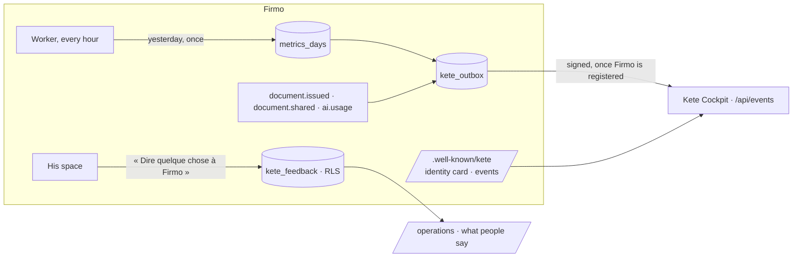

# Feature Specification: Firmo on today's Kete chassis

**Feature Branch**: `015-kete-current`
**Created**: 2026-10-08
**Status**: Implemented
**Input**: The author, on 2026-10-07: « Fais le plan de ce qu'il faut actualiser dans Firmo et
fais-le. Firmo reste sur luna. » Firmo had not moved since 2026-09-30, while `kete-core` was
consolidated (doctrine D-034): its packages were four to five versions behind, its manifest said
the minimum, and nothing it emitted reached Kete Cockpit.

## What changes

## User Scenarios & Testing

### The chassis (P1)

1. **Given** `kete-core` today, **Then** Firmo builds, type-checks and passes its 196 tests on
   `@kete/auth` 0.3, `@kete/design` 0.6, `@kete/files` 0.4 and `@kete/sdk` 0.6; `@kete/payments`,
   which Firmo never imported (the Compte Kete holds the payment port), leaves its dependencies.
2. **Given** `/.well-known/kete`, **Then** Firmo carries its identity card (doctrine D-040): Kete
   answers for it; it handles personal, financial and confidential data; it calls a model to
   transcribe and read, never to write an amount; an outage slows work down (`medium`).

### What he tells Kete (P1)

1. **Given** his space, **Then** « Dire quelque chose à Firmo » takes what goes wrong, an idea or
   what works, with the page he was on.
2. **Given** a feedback, **Then** it is kept in his organization (RLS), added and read by the
   application, never changed nor removed; another organization reads none of it.
3. **Given** a request without a session, **Then** nothing is kept (401).
4. **Given** the operator space, **Then** Kete operators read the latest: what was said and where,
   the organization, never the person.

### The day's figures (P1)

1. **Given** a day that ended (UTC), **Then** the worker announces `metrics.daily` once, under
   Kete's own organization: documents issued, organizations issuing, shares first opened,
   messages received and failed, senders active, model calls, feedback received.
2. **Given** these figures, **Then** they are counters only — never a price, a client, a number
   nor a sender (constitution; decision 0001).
3. **Given** a process that was down when the day turned, **Then** the next hourly round
   announces it; a day already announced is never announced twice.

### Kete Cockpit hears Firmo (P1)

1. **Given** an operator who registered Firmo's address in the Cockpit, **Then**
   `pnpm cockpit:connect` asks for the key the Cockpit showed, sends it straight to the hosting
   environment with the receiver's address, and redeploys — the key is never printed nor written.
2. **Given** `pnpm cockpit:status`, **Then** it says how many events wait, and since when.
3. **Given** a Cockpit on `@kete/sdk` 0.2, **Then** it refuses a manifest that carries an
   identity card: the Cockpit moves to 0.6 first (`kete-africa/kete-cockpit#3`).

## Requirements

- **FR-001** Every table of this spec is created with its RLS policy, and is append-only for the
  application role (`kete_feedback`, `metrics_days`).
- **FR-002** The model stays the one configured (`OPENAI_MODEL`, by default `gpt-5.6-luna`):
  this spec changes no call to it.
- **FR-003** Registering Firmo in the Cockpit stays an operator's gesture, signed in with two
  factors: no script writes the Cockpit's registry in his place.

## Left out, and why

- **Moving Firmo's model adapter to `@kete/ai`.** Its conversation was tuned and evaluated on the
  real model (`pnpm eval:conversation`); the Cockpit already hears its cost (`ai.usage`). A
  rewrite would risk the reading for no gain a tradesman would see.
- **Reusing his past prices, automatic reminders.** Still waiting for the author's ok
  (spec 011); the second one contradicts `docs/product/voix.md` as it stands.

## Proof

- `[agent]` `tests/chassis.test.ts`: the identity card; feedback kept per organization, append-only,
  taken over HTTP from the signed-in person only, read by operators without the person; the day's
  figures announced once, as counters, under Kete's organization.
- `[agent]` The whole suite on the new packages (19 files, 204 tests).
- `[human]` Firmo registered in the staging Cockpit; `pnpm cockpit:status` says no event waits.
