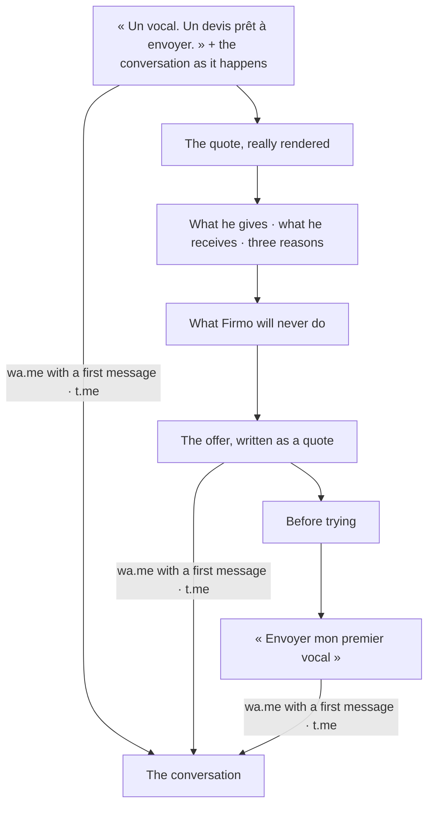

# Feature Specification: The public page

**Feature Branch**: `016-landing`
**Created**: 2026-10-08
**Status**: Implemented
**Input**: The author, on 2026-10-07: « Pour la landing page utilise le principe de Hormozi. »
Firmo's address answered with its name and one sentence. The reference version had a validated
page (`../../projects_labs/firmo`, `references/validated/landing`): its words and its order are the
base; the value equation orders what it says.

## The principle, applied to Firmo

Hormozi's value equation: an offer is worth what it promises and how believable it is, divided by
how long it takes and what it costs in effort and risk. Each part of the page answers one term —
in the tradesman's words, never as a formula.

| Term | What the page says | Where |
|---|---|---|
| The result he wants | A document taken seriously, in his name — « Un devis prêt à envoyer » | the title; the quote shown |
| Why he can believe it | He sees what was read before anything leaves; the quote shown is a real rendering | the conversation; « Regarde ce qu'il devient » |
| How soon | On the spot, while it is fresh | « Sur place, pendant que c'est frais » |
| At what effort | A voice note; nothing to install, no account, no password | « Ce que tu donnes »; « Tu n'apprends rien de nouveau » |
| At what risk | Three documents offered, no card; what Firmo will never do | the offer; « Ce qu'on ne fera jamais » |

## User Scenarios & Testing

### He understands and tries (P1)

1. **Given** the page on a phone (375 px), **Then** the title, what happens in the conversation and
   the first gesture — « Essayer avec un vocal » — are read without scrolling sideways.
2. **Given** « Essayer avec un vocal », **Then** WhatsApp opens on Firmo's number with a first
   message already written; Telegram is offered beside it when both are configured; with a photo
   of his paper, the same.
3. **Given** the quote shown, **Then** it is the first page of a PDF rendered by Firmo's own
   renderer (`pnpm landing:sample`), it opens as a PDF, and the page says it is a demonstration:
   the workshop, the client and the amounts are fictitious.
4. **Given** the offer, **Then** it is written as a quote — lines, quantities, amounts, a total:
   the first three documents and every correction at 0 F CFA, no card; then thirty final
   documents per period of thirty days at 2 000 F CFA. The figures come from the plans.
5. **Given** French or English, **Then** every word comes from the catalogs, in the voice of
   `docs/product/voix.md`: « tu », no exclamation mark, none of the banned words.

### What the page never does (P1)

1. It claims no proof that does not exist (`docs/product/strategie.md`): no testimonial, no number
   of users, no measured time, no business won.
2. It invents no scarcity and no deadline — the two levers of the principle that honesty rules out
   here — and no bonus.
3. It asks nothing of a visitor: no form, no field, no cookie beyond the language.
4. It shows no price suggestion, and says Firmo never makes one.

## Requirements

- **FR-001** The channels' addresses come from the configuration (`FIRMO_WHATSAPP_NUMBER`,
  `FIRMO_TELEGRAM_BOT`); without any, the page says so and offers no dead button.
- **FR-002** The page's figures (3, 30, 30, 2 000) come from `@/features/plans`; the price charged
  is the Firmo offer's at the Compte Kete, and the two are kept equal (`docs/OPERATIONS.md`).
- **FR-003** The visual world is the product's (`@kete/design`: ink, sand, clay; Archivo,
  Instrument Sans, JetBrains Mono for figures). The page is composed like the document it sells:
  rules, aligned columns, tabular figures. One authored motion — the conversation arriving in
  order — only for who accepts motion.
- **FR-004** The social card shows the quote, never the logo (`docs/product/identite.md`).

## Left out, and why

- **The legal pages** (terms, privacy, data deletion, contact) of the reference version: their
  text is the author's to approve before it is published under Kete's name; Meta asks for them
  before the WhatsApp number goes live in production.
- **Measurement** (`docs/product/contenus.md` names PostHog events): no analytics service is
  connected to the new Firmo; the Cockpit counts what follows — messages received, documents
  issued (spec 012).

## Proof

- `[agent]` `e2e/landing.spec.ts`: at 375 px, in French and English — the title, the gesture to
  WhatsApp with its first message, the offer's figures, no field, no sideways scroll; the
  demonstration PDF and its image are served.
- `[agent]` Captures at 1280 px and 375 px read before delivery; the design detector finds nothing.
- `[human]` The author reads the page aloud: if it sounds like software, the voice is not found
  (`docs/product/voix.md`).
