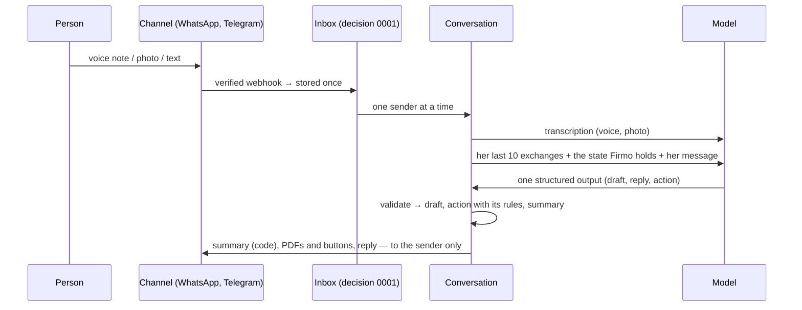

# Conversation

A tradesman writes, speaks or photographs his sale on WhatsApp or Telegram; Firmo reads it, shows
what it understood, asks one question at a time, and issues the PDF once he says yes.

## One structured turn per message

Decision 0003. The model reads the sender's own conversation and answers with **one structured
output** (`turn.ts`), enforced by the model's API and validated with Zod:

| Field                                   | What the code does with it                                                            |
| --------------------------------------- | ------------------------------------------------------------------------------------- |
| `draft`                                 | the whole draft as the model understands it; kept as is (null: unchanged)             |
| `reply`                                 | sent after the code's own messages, unless the code already asked the only question   |
| `action`                                | run with its rules: preview, propose/confirm/cancel the issuance, PDF, convert, links |
| `issuer_name`, `new_document`, `number` | the issuer's name saved; a new document starts afresh; the document an action aims at |

What a schema cannot say — a line priced two ways, a percentage above 100 — goes back to the
model once, with what to fix. An issuance happens only after a proposal and a yes (words or
button), on the exact previewed draft, within the plans. The code writes every amount the person
reads: the summary, from the documents feature's exact calculation.

## Memory

One conversation per sender and channel, in her organization; nothing at the model's provider.
The model reads her last 10 exchanges — what she wrote and what Firmo actually sent (links masked,
PDFs by their caption) — and the state: issuer name, pending proposal, recent documents, the draft,
what is missing. An issued or a new document starts the exchanges afresh.

## The working draft

`draft.ts` — sections, lines, adjustments, facts, as exact decimal text. It is complete when it
has priced lines, a client and a subject; what is missing is shown in the summary and asked, one
question at a time. It becomes a document draft only to be previewed or issued.

## Privacy

A message's body lives in the inbox until it is handled, then is erased. Voice notes and photos
are never kept: only what was heard or read, in the conversation's recent exchanges, in the
person's organization.

## Proof

- `tests/conversation.test.ts` — with a scripted model: a sale to an issued PDF, what the model
  reads (the exchange, the summary it was shown, the state), a draft sent back once then a neutral
  reply, no issuance without a proposal, a changed draft voids the proposal, the plans, two
  senders at once (each call reads only its sender), Telegram's contact.
- `pnpm eval:conversation` — with the real model: real conversations word for word (the author's
  « un tube annellé », numbers in words, corrections and removals, a price never invented) and the
  reference's four dialogues played by a second model; the code judges the final state and
  reports the cost.
