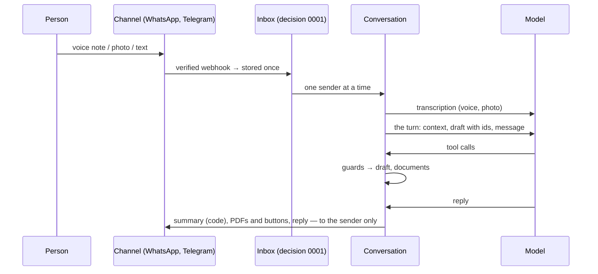

# Conversation

A tradesman writes, speaks or photographs his sale on WhatsApp or Telegram; Firmo reads it, shows
what it understood, asks one question at a time, and issues the PDF once he says yes.

## A bounded agent

One model turn per message (decision 0002). The model acts only through **tools**, and each tool
is a use case with its guard — the model proposes, the code checks and applies:

| Tool                                                                | Guard                                                                                                      |
| ------------------------------------------------------------------- | ---------------------------------------------------------------------------------------------------------- |
| `add_to_draft`                                                      | every number comes with words of **this** message that **contain** it; otherwise the whole call is refused |
| `change_draft`                                                      | elements named by stable ids (`L3`, `S1`, `A2`); the client's name must be words of the message            |
| `remove_from_draft`                                                 | only ids that exist                                                                                        |
| `set_issuer_name`                                                   | the name must be words of the message                                                                      |
| `show_preview`, `propose_issue`                                     | a complete draft and an issuer name; the preview's snapshot hash is kept                                   |
| `confirm_issue`                                                     | an issuance was proposed **and** the person said yes (or pressed the button)                               |
| `send_latest_pdf`, `convert_latest`, `find_documents`, `open_space` | the person's own organization only                                                                         |

The code writes every amount the person reads (the summary, from the documents feature's exact
calculation); the model's reply may not state a number the code did not produce (`guardReply`).

## The working draft

`draft.ts` — what was understood, before it becomes a document: sections, lines, adjustments,
facts, each with an id. It is complete when it has priced lines, a client and a subject; the first
missing item is the next question. It becomes a document draft only to be previewed or issued.

## Privacy

A message's body lives in the inbox until it is handled, then is erased. Voice notes and photos
are never kept: only what was heard or read, in the conversation's recent exchanges, in the
person's organization.

## Proof

- `tests/conversation.test.ts` — journeys with a scripted model: a sale to an issued PDF, a price
  that was not said, a reply with an invented total, no "yes" no issuance, two senders at once,
  Telegram's contact.
- `pnpm eval:conversation` — the reference's four dialogues with the real model; a second model
  plays the tradesman, the code judges the final state and reports the cost per conversation.
