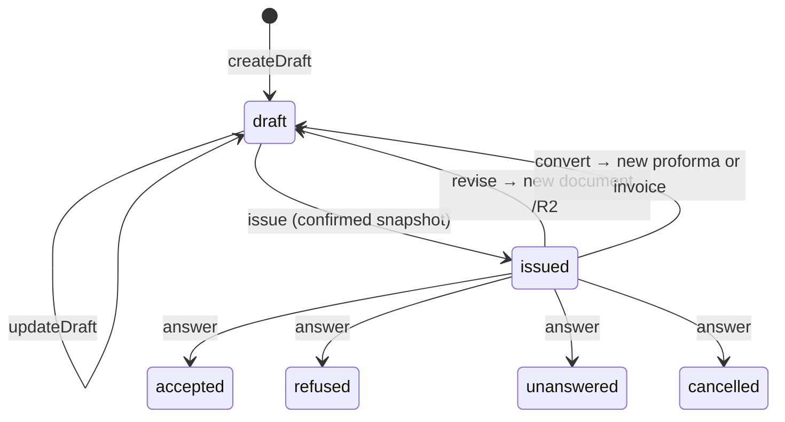
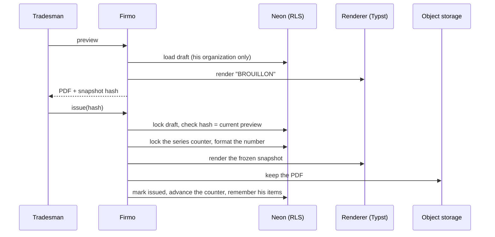

# Documents

The anchor of Firmo: a quote, a proforma or an invoice. His prices, our presentation.

## Model

A document is a sequence of **sections** (optional title and subtotal), each holding **lines**
(`quantity × unit price`, a flat amount, or a descriptive line), then ordered **adjustments** on an
explicit base (labour, transport, a discount, a tax), a requested deposit, and — for an invoice —
**payments**. Clauses are written once per organization and copied onto the document.

## Lifecycle

- **Draft**: no number; totals computed on read.
- **Issued**: immutable — number burnt, snapshot (totals, header, clauses) frozen, PDF kept. The
  database refuses any change to its content, even from the application's role.

## Issuance

## Rules kept from the reference

- Exact decimal arithmetic, rounded half-up to the franc; nothing is ever suggested or corrected.
- A line Firmo could not read (`confirmationRequired`) makes the draft not issuable.
- Numbering: one series per type (`DEV`, `PRO`, `FAC` by default), annual or continuous; a manual
  number must be valid, unused and outside the automatic series; a revision is `<root>/R<n>`.
- Conversion goes forward only: quote → proforma or invoice, proforma → invoice.
- A payment never exceeds the balance due.
- Another organization's document is **not found**, never forbidden.

## Entry point

`index.ts`: `createDocuments({ renderer, files })` and the pure domain (calculations, numbering,
snapshots, presentation). The renderer and file storage are ports; their adapters live in
`src/platform` (`typst.ts`, `files.ts`).
