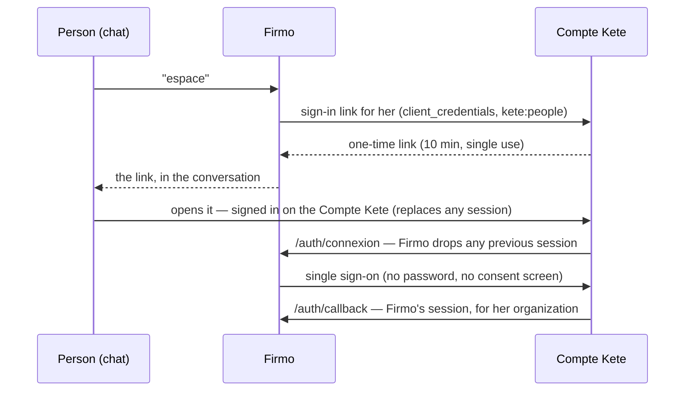

# Identity

Who writes to Firmo, and who opens its web space (doctrine D-024, kete-core spec 013).

## A sender is one person and one organization

The channel proves the sender: WhatsApp gives the number (Meta attests it); Telegram gives a user
id, and the number only once the person shares **her own** contact (Telegram's "share my number"
button — a contact carrying another user id is refused). On the first message, Firmo asks the
Compte Kete for the person with that number: she is created in silence, with an organization she
owns. Firmo keeps `(channel, sender) → (person, organization)` in `messaging_identities`, isolated
by organization; `find_messaging_identity` answers for one proven sender at a time and never lists.

## The web space opens through a one-time link

Whoever opens a link becomes the person of that link, never the one who used the browser before:
the Compte Kete replaces its session when the link is opened, and Firmo drops its own at
`/auth/connexion`. The session is an HTTP-only cookie signed with Firmo's secret.

## Entry point

`index.ts`: `createIdentity({ directory, publicUrl })` — `resolveSender(proof)` and
`spaceLink(personId, path)`. The Compte Kete adapter is `src/platform/account.ts`; the web session
is `src/platform/signin.ts`.
