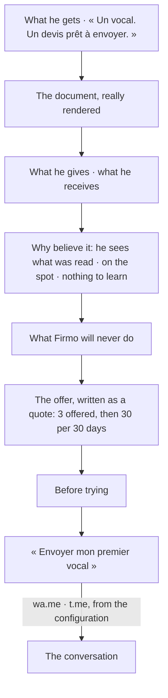

# Landing (spec 013)

Firmo's public page, at `/`: one offer and the way into the conversation.

- `functions.ts` reads where the conversation opens (`FIRMO_WHATSAPP_NUMBER`,
  `FIRMO_TELEGRAM_BOT`) and the offer's figures (`@/features/plans`): nothing is written in the page.
- `ui.tsx` is the page; every word comes from the catalogs, in the voice of `docs/product/voix.md`.
- The quote shown is rendered by Firmo's renderer from a fictitious sale (`pnpm landing:sample`
  writes `public/landing/devis-exemple.{pdf,png}`), and the page says it is a demonstration.
- No proof is claimed that does not exist (`docs/product/strategie.md`): no testimonial, no
  measured time, no number of users, no scarcity.
