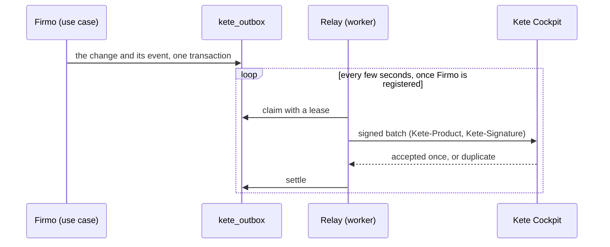

# Operations

Kete operators run Firmo; Kete Cockpit sees it live (spec 008).

## Who is an operator

A member of Kete's own organization at the Compte Kete (`KETE_OPERATORS_ORGANIZATION_ID`), owner
or admin, signing in with a second factor — the Cockpit's rule (kete-core spec 008). The check runs
on every server call of `/operations`, not only on the page. Without the variable, nobody is.

## What an operator sees and does

- **Failed messages**: when, the channel, the error code, the attempts, the organization — the
  sender masked to its last four characters. Never a body: it is erased once the message is
  settled (decision 0001), so a failed message cannot be replayed; the person was told to try again.
- **An exceptional reading**: an issued document of an organization, by its number, for a reason.
  The document is found and the reading journaled in the same transaction, inside that
  organization (RLS) — without the journal entry, nothing is read.
- **The journal**: who read what, when, and why. The application role can only add to it; the
  space reads it through a definer function (`operator_journal_recent`).

## What Kete Cockpit hears

| Event             | When                    | Data                                           |
| ----------------- | ----------------------- | ---------------------------------------------- |
| `document.issued` | a document is issued    | `document_type`, `correction`                  |
| `document.shared` | a share link is created | `document_type`                                |
| `ai.usage`        | a turn called the model | `model_calls`, `input_tokens`, `output_tokens` |

Facts and counters only — never a price, a client, a number or a message. The relay starts when
`KETE_RECEIVER_URL`, `KETE_KEY_ID` and `KETE_KEY_SECRET` are set; until then, events wait.
