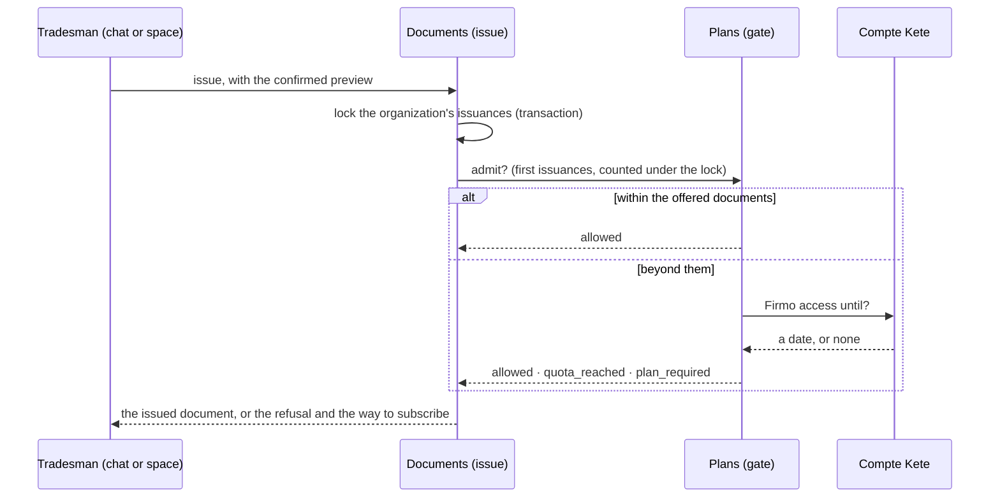

# Plans

Firmo is paid through the Compte Kete, and never gives more than what was bought (spec 007).

## The rule

- **Three final documents are offered.** Drafts, previews and corrections (`/R2`) never count:
  only a first issuance does.
- Then the **Firmo offer** of the Compte Kete: **thirty documents per rolling thirty days** while
  it is active (its grace included). The offered documents are never counted in that period.
- The Compte Kete says only until when the Firmo access runs (kete-core spec 014,
  `GET /api/apps/access`) — never a price, a name or a payment. Firmo applies its own rule.

## Where it is decided

The lock makes the check and the consumption one step: two issuances racing for the last document
never both succeed. Without the Compte Kete answering beyond the offered documents, issuance fails
closed (`plans_unavailable`) — nothing is given that was not bought.

## Subscribing

- In the space: **Abonnement** (`/espace/abonnement`) shows where the organization stands and
  opens the Compte Kete's subscriptions, where the payment happens (Chariow, behind its port).
- In the chat: the `open_subscription` tool sends a one-time link to that page; a refused issuance
  sends it too, written by the code. The proposed issuance stays pending: once subscribed, "oui"
  issues it.
