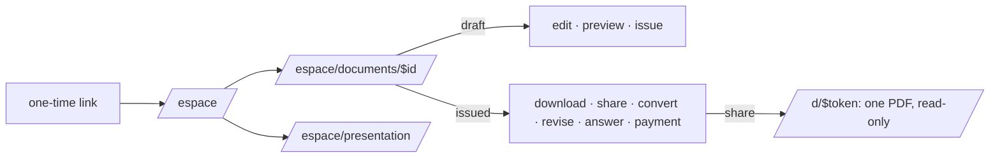

# Web space

The tradesman's space, reached from the conversation's one-time link (identity feature), purpose-
built at 375 px from the validated reference screens: calm, the document's own rules; his colour
belongs to his documents only, never to the interface.

| Screen        | Route                   | What it does                                                                                                                                              |
| ------------- | ----------------------- | --------------------------------------------------------------------------------------------------------------------------------------------------------- |
| Documents     | `/espace`               | the draft to continue, the recent ones, back to the conversation to create                                                                                |
| All documents | `/espace/documents`     | every document, searched by client, subject or number                                                                                                     |
| One document  | `/espace/documents/$id` | lines and groups, conditions, totals (the server's); edit while a draft; issue after seeing the preview; share, convert, revise, answer, record a payment |
| Presentation  | `/espace/presentation`  | identity, logo, colour, legal mentions, defaults, clauses, numbering — seen on the **real** rendering of a sample first page                              |

Files: `/api/documents/$id/pdf` (preview or issued PDF), `/api/presentation/preview` (PNG),
`/api/presentation/logo` (made safe: real format, re-encoded, no metadata), and the public
`/d/$token` — **one** issued document for his client, read-only, revocable, counted without any
address or fingerprint.

Every server function finds the person from her session and works in her organization only;
another organization's document is not found.
